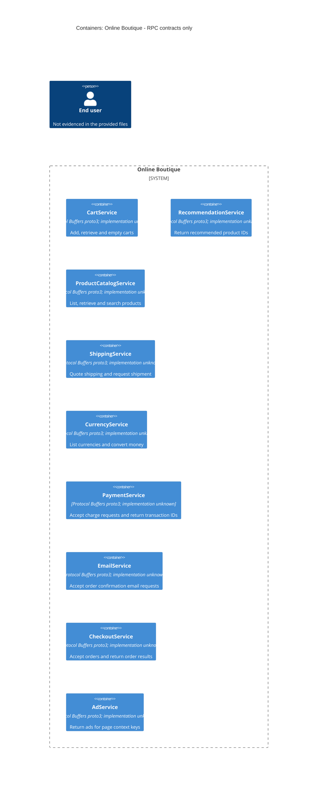

# Agent

Codex — ไม่ทราบชื่อรุ่นโมเดลที่แน่ชัด

# Files read

- `AGENTS.md` — กติกา repository
- `prompts/1-recover-architecture.md` — คำสั่งของงาน
- `system/online-boutique/protos/demo.proto` — หลักฐานสถาปัตยกรรม

# Containers table

ตารางแสดง 9 บริการที่ประกาศในสัญญา RPC การแยกแต่ละบริการเป็น container ที่รันอิสระ: Not evidenced in the provided files หลักฐานของรูปแบบสัญญาคือ `system/online-boutique/protos/demo.proto:15` (`syntax = "proto3"`) ภาษา implementation และ runtime ของทุกบริการ: Not evidenced in the provided files ส่วน `go_package` ที่บรรทัด 19 ไม่ยืนยันว่าทุกบริการเขียนด้วย Go

| ชื่อ | เทคโนโลยี/ภาษา | หน้าที่ตามสัญญา | หลักฐาน (ไฟล์และสัญลักษณ์) |
| --- | --- | --- | --- |
| CartService | Protocol Buffers proto3; ภาษา implementation ไม่ทราบ | เพิ่มสินค้า อ่านตะกร้า และล้างตะกร้าของผู้ใช้ | `system/online-boutique/protos/demo.proto` บรรทัด 23–50 — `AddItem, GetCart, EmptyCart, Cart.user_id` |
| RecommendationService | Protocol Buffers proto3; ภาษา implementation ไม่ทราบ | รับผู้ใช้และรหัสสินค้า แล้วคืนรหัสสินค้าที่แนะนำ | `system/online-boutique/protos/demo.proto` บรรทัด 56–67 — `ListRecommendations, ListRecommendationsRequest, ListRecommendationsResponse` |
| ProductCatalogService | Protocol Buffers proto3; ภาษา implementation ไม่ทราบ | แสดงรายการ อ่านรายละเอียด และค้นหาสินค้า | `system/online-boutique/protos/demo.proto` บรรทัด 71–103 — `ListProducts, GetProduct, SearchProducts` |
| ShippingService | Protocol Buffers proto3; ภาษา implementation ไม่ทราบ | ขอราคาจัดส่งและส่งคำขอจัดส่งเพื่อรับรหัสติดตาม | `system/online-boutique/protos/demo.proto` บรรทัด 107–128 — `GetQuote, ShipOrder, ShipOrderResponse.tracking_id` |
| CurrencyService | Protocol Buffers proto3; ภาษา implementation ไม่ทราบ | แสดงสกุลเงินที่รองรับและแปลงจำนวนเงิน | `system/online-boutique/protos/demo.proto` บรรทัด 140–173 — `GetSupportedCurrencies, Convert, CurrencyConversionRequest` |
| PaymentService | Protocol Buffers proto3; ภาษา implementation ไม่ทราบ | รับคำขอเรียกเก็บเงินด้วยข้อมูลบัตรและคืนรหัสธุรกรรม | `system/online-boutique/protos/demo.proto` บรรทัด 177–195 — `Charge, ChargeRequest, ChargeResponse.transaction_id` |
| EmailService | Protocol Buffers proto3; ภาษา implementation ไม่ทราบ | รับคำขอส่งอีเมลยืนยันคำสั่งซื้อ | `system/online-boutique/protos/demo.proto` บรรทัด 199–201, 216–219 — `SendOrderConfirmation, SendOrderConfirmationRequest` |
| CheckoutService | Protocol Buffers proto3; ภาษา implementation ไม่ทราบ | รับคำขอสั่งซื้อและคืนผลคำสั่งซื้อ | `system/online-boutique/protos/demo.proto` บรรทัด 224–239 — `PlaceOrder, PlaceOrderRequest, PlaceOrderResponse` |
| AdService | Protocol Buffers proto3; ภาษา implementation ไม่ทราบ | รับคำสำคัญของหน้าและคืนรายการโฆษณา | `system/online-boutique/protos/demo.proto` บรรทัด 243–262 — `GetAds, AdRequest.context_keys, AdResponse.ads` |

# Dependencies table

| ผู้เรียก → ผู้ถูกเรียก | Protocol | หลักฐาน (ไฟล์และสัญลักษณ์) |
| --- | --- | --- |

ไม่พบคู่ runtime dependency ที่ยืนยันได้: Not evidenced in the provided files จึงไม่มีแถว dependency และไม่มีเส้น `Rel` ในแผนภาพ คำประกาศ `service` และ `rpc` ใน `system/online-boutique/protos/demo.proto` ระบุ API แต่ไม่ระบุ client หรือจุดเรียกใช้งาน การใช้ message ร่วมกัน เช่น `Money` และ `OrderResult` ไม่ยืนยันการเรียกข้ามบริการ

# Mermaid diagram

แผนภาพตรงกับตาราง โดยแสดงเฉพาะบริการตามสัญญา ชื่อระบบและ `Person` เป็นกรอบตามโจทย์ ตัวตนและช่องทางเชื่อมต่อของผู้ใช้: Not evidenced in the provided files จึงไม่มีเส้นเชื่อมผู้ใช้ ไม่มี data store หรือระบบภายนอกที่ยืนยันได้จากไฟล์นี้

# Gaps

ทุกประเด็นต่อไปนี้มีสถานะ Not evidenced in the provided files ไฟล์เพิ่มเติมเป็นข้อเสนอสำหรับขยายหลักฐาน ยังไม่ได้อ่านหรือยืนยันว่ามีอยู่

| สิ่งที่ยังระบุไม่ได้ | ข้อจำกัดของหลักฐาน | ไฟล์เพิ่มเติมที่จะช่วยยืนยัน |
| --- | --- | --- |
| ขอบเขต container ที่ deploy จริงและภาษา implementation | คำประกาศ `service` และ `go_package` ใน `demo.proto` ไม่ระบุ process หรือ deployment | manifest ของแต่ละบริการใน `system/online-boutique/kubernetes-manifests/` และ Dockerfile/ไฟล์ implementation ใน `system/online-boutique/src/` |
| คู่ dependency และลำดับการทำงานของ CheckoutService | `demo.proto:224–239` ระบุ API และข้อมูลเข้าออก ไม่ระบุบริการที่ถูกเรียก | ไฟล์ implementation ของ RPC client และจุดเรียกใน `system/online-boutique/src/` พร้อม manifest ที่กำหนดปลายทาง |
| Protocol ที่ใช้จริง รวมถึง gRPC, HTTP/2 และ TLS | `rpc` ใน `demo.proto` ไม่แสดงการตั้งค่า transport ที่รันจริง | ไฟล์เริ่มต้น server/client และการตั้งค่า transport ใน `system/online-boutique/src/` |
| frontend และช่องทางผู้ใช้ | ไม่มีคำประกาศ frontend หรือ client ของผู้ใช้ใน `demo.proto` | manifest และไฟล์ implementation ของ frontend หากมี |
| Data store, message broker และการเก็บข้อมูลถาวร | `Cart`, `Product` และ `OrderResult` เป็น message ไม่ใช่หลักฐานของที่จัดเก็บ | manifest และไฟล์ implementation ส่วนจัดเก็บข้อมูลหรือ messaging ของบริการ |
| ผู้ให้บริการภายนอกและพฤติกรรมจริงของการชำระเงิน จัดส่ง และอีเมล | `Charge`, `ShipOrder` และ `SendOrderConfirmation` ไม่ระบุ integration หรือผลข้างเคียงจริง | ไฟล์ implementation และการตั้งค่า integration ของ PaymentService, ShippingService และ EmailService |
| เหตุผลการแบ่งบริการและคุณลักษณะด้านคุณภาพ | `demo.proto` ไม่ระบุ rationale หรือข้อกำหนดด้านคุณภาพ | เอกสารข้อกำหนดหรือบันทึกการตัดสินใจที่ได้รับอนุญาตเพิ่มเติม |
