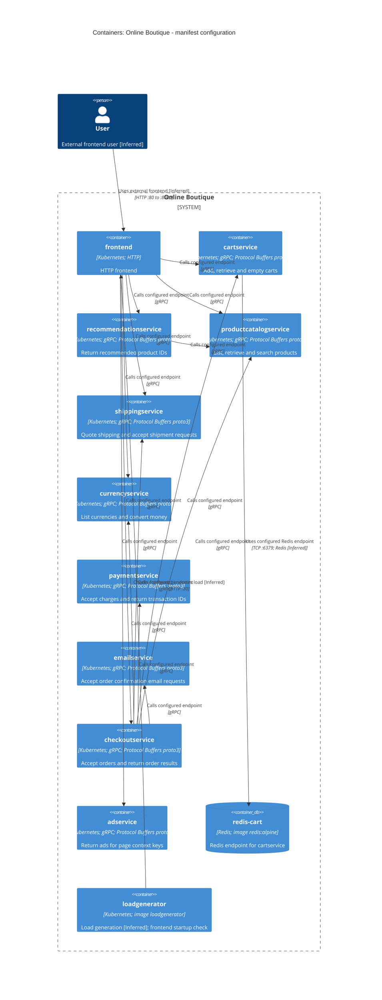

# Agent

Codex — GPT-6

# Files read

- `AGENTS.md`
- `prompts/1-recover-architecture.md`
- `system/online-boutique/protos/demo.proto`
- `system/online-boutique/kubernetes-manifests/README.md`
- `system/online-boutique/kubernetes-manifests/adservice.yaml`
- `system/online-boutique/kubernetes-manifests/cartservice.yaml`
- `system/online-boutique/kubernetes-manifests/checkoutservice.yaml`
- `system/online-boutique/kubernetes-manifests/currencyservice.yaml`
- `system/online-boutique/kubernetes-manifests/emailservice.yaml`
- `system/online-boutique/kubernetes-manifests/frontend.yaml`
- `system/online-boutique/kubernetes-manifests/kustomization.yaml`
- `system/online-boutique/kubernetes-manifests/loadgenerator.yaml`
- `system/online-boutique/kubernetes-manifests/paymentservice.yaml`
- `system/online-boutique/kubernetes-manifests/productcatalogservice.yaml`
- `system/online-boutique/kubernetes-manifests/recommendationservice.yaml`
- `system/online-boutique/kubernetes-manifests/shippingservice.yaml`

# Containers table

สรุปโครงสร้างที่ manifest กำหนดไว้ ไม่ใช่ผลตรวจระบบที่กำลังรัน: `system/online-boutique/kubernetes-manifests/README.md:3–5` ระบุว่าต้องใช้ skaffold ใส่ image tag ก่อน deploy ภาษา implementation ของบริการทั้งหมด: Not evidenced in the provided files; `demo.proto:15,19` ระบุ proto3 และ go_package แต่ไม่ยืนยันภาษาของแต่ละบริการ

`loadgenerator` รวมอยู่เพราะมี Deployment ในหลักฐาน แต่ `system/online-boutique/kubernetes-manifests/kustomization.yaml:24` คอมเมนต์ resource นี้ออก โดยอ้างถึงโมดูลใน skaffold ซึ่งไม่ได้อ่าน init container `frontend-check` เป็นส่วนเริ่มต้นของ loadgenerator จึงรวมใน container เชิงสถาปัตยกรรมเดียวกัน (หลักฐาน: `loadgenerator.yaml:40–83` ในไดเรกทอรีเดียวกัน) Kubernetes Service และ ServiceAccount ไม่แยกเป็น C4 container เพราะไม่ได้ประกาศ workload เพิ่ม

| ชื่อ | เทคโนโลยี/ภาษา | หน้าที่ | หลักฐาน (ไฟล์และสัญลักษณ์) |
| --- | --- | --- | --- |
| frontend | Kubernetes; HTTP | รับคำขอ HTTP และกำหนดปลายทางบริการเบื้องหลัง | system/online-boutique/kubernetes-manifests/frontend.yaml (`Deployment/frontend`, `httpGet`, `env.*_SERVICE_ADDR`, `Service/frontend-external`) |
| cartservice | Kubernetes; gRPC; Protocol Buffers proto3 | เพิ่มสินค้า อ่านตะกร้า และล้างตะกร้า | system/online-boutique/kubernetes-manifests/cartservice.yaml (`Deployment/cartservice`, `Service.ports[name=grpc]`); system/online-boutique/protos/demo.proto (`CartService`) |
| recommendationservice | Kubernetes; gRPC; Protocol Buffers proto3 | คืนรายการรหัสสินค้าที่แนะนำ | system/online-boutique/kubernetes-manifests/recommendationservice.yaml (`Deployment/recommendationservice`, `Service.ports[name=grpc]`); system/online-boutique/protos/demo.proto (`RecommendationService`) |
| productcatalogservice | Kubernetes; gRPC; Protocol Buffers proto3 | แสดงรายการ อ่านรายละเอียด และค้นหาสินค้า | system/online-boutique/kubernetes-manifests/productcatalogservice.yaml (`Deployment/productcatalogservice`, `Service.ports[name=grpc]`); system/online-boutique/protos/demo.proto (`ProductCatalogService`) |
| shippingservice | Kubernetes; gRPC; Protocol Buffers proto3 | ให้ราคาจัดส่งและรับคำขอจัดส่งเพื่อคืนรหัสติดตาม | system/online-boutique/kubernetes-manifests/shippingservice.yaml (`Deployment/shippingservice`, `Service.ports[name=grpc]`); system/online-boutique/protos/demo.proto (`ShippingService`) |
| currencyservice | Kubernetes; gRPC; Protocol Buffers proto3 | แสดงสกุลเงินที่รองรับและแปลงจำนวนเงิน | system/online-boutique/kubernetes-manifests/currencyservice.yaml (`Deployment/currencyservice`, `Service.ports[name=grpc]`); system/online-boutique/protos/demo.proto (`CurrencyService`) |
| paymentservice | Kubernetes; gRPC; Protocol Buffers proto3 | รับคำขอเรียกเก็บเงินและคืนรหัสธุรกรรม | system/online-boutique/kubernetes-manifests/paymentservice.yaml (`Deployment/paymentservice`, `Service.ports[name=grpc]`); system/online-boutique/protos/demo.proto (`PaymentService`) |
| emailservice | Kubernetes; gRPC; Protocol Buffers proto3 | รับคำขอส่งอีเมลยืนยันคำสั่งซื้อ | system/online-boutique/kubernetes-manifests/emailservice.yaml (`Deployment/emailservice`, `Service.ports[name=grpc]`); system/online-boutique/protos/demo.proto (`EmailService`) |
| checkoutservice | Kubernetes; gRPC; Protocol Buffers proto3 | รับคำขอสั่งซื้อและคืนผลคำสั่งซื้อ | system/online-boutique/kubernetes-manifests/checkoutservice.yaml (`Deployment/checkoutservice`, `Service.ports[name=grpc]`); system/online-boutique/protos/demo.proto (`CheckoutService`) |
| adservice | Kubernetes; gRPC; Protocol Buffers proto3 | รับคำสำคัญของหน้าและคืนรายการโฆษณา | system/online-boutique/kubernetes-manifests/adservice.yaml (`Deployment/adservice`, `Service.ports[name=grpc]`); system/online-boutique/protos/demo.proto (`AdService`) |
| redis-cart | Redis; image redis:alpine | เป็นปลายทาง Redis ของ cartservice; โครงสร้างข้อมูลที่เก็บยังไม่ทราบ | system/online-boutique/kubernetes-manifests/cartservice.yaml (`REDIS_ADDR=redis-cart:6379`, `Deployment/redis-cart`, `image: redis:alpine`, `redis-data.emptyDir`) |
| loadgenerator | Kubernetes; image loadgenerator | [Inferred] สร้างโหลดไปยัง frontend ตามชื่อและตัวแปร USERS/RATE; มี init container ตรวจ frontend | system/online-boutique/kubernetes-manifests/loadgenerator.yaml (`Deployment/loadgenerator`, `FRONTEND_ADDR`, `USERS`, `RATE`, `initContainers[name=frontend-check]`); system/online-boutique/kubernetes-manifests/kustomization.yaml:24 |

# Dependencies table

เส้นระหว่างบริการแสดง dependency ที่กำหนดผ่านที่อยู่ใน manifest ส่วน gRPC อ้างอิงชื่อ port และ gRPC probe ของปลายทาง ไม่ยืนยันว่ามีการเรียกทุกเส้นจริงในทุกคำขอ หรือเรียก RPC method ใด ทุกความสัมพันธ์ที่อนุมานติดป้าย [Inferred]

| ผู้เรียก → ผู้ถูกเรียก | Protocol | หลักฐาน (ไฟล์และสัญลักษณ์) |
| --- | --- | --- |
| ผู้ใช้ → frontend | HTTP :80 → :8080 | [Inferred] ผู้ใช้เข้าผ่าน system/online-boutique/kubernetes-manifests/frontend.yaml:123–136 (`Service/frontend-external`, `type: LoadBalancer`, `ports[name=http]`); หลักฐานไม่ระบุตัวตนผู้ใช้ |
| frontend → productcatalogservice | gRPC | system/online-boutique/kubernetes-manifests/frontend.yaml (`PRODUCT_CATALOG_SERVICE_ADDR=productcatalogservice:3550`); system/online-boutique/kubernetes-manifests/productcatalogservice.yaml (`Service.ports[name=grpc]`) |
| frontend → currencyservice | gRPC | system/online-boutique/kubernetes-manifests/frontend.yaml (`CURRENCY_SERVICE_ADDR=currencyservice:7000`); system/online-boutique/kubernetes-manifests/currencyservice.yaml (`Service.ports[name=grpc]`) |
| frontend → cartservice | gRPC | system/online-boutique/kubernetes-manifests/frontend.yaml (`CART_SERVICE_ADDR=cartservice:7070`); system/online-boutique/kubernetes-manifests/cartservice.yaml (`Service.ports[name=grpc]`) |
| frontend → recommendationservice | gRPC | system/online-boutique/kubernetes-manifests/frontend.yaml (`RECOMMENDATION_SERVICE_ADDR=recommendationservice:8080`); system/online-boutique/kubernetes-manifests/recommendationservice.yaml (`Service.ports[name=grpc]`) |
| frontend → shippingservice | gRPC | system/online-boutique/kubernetes-manifests/frontend.yaml (`SHIPPING_SERVICE_ADDR=shippingservice:50051`); system/online-boutique/kubernetes-manifests/shippingservice.yaml (`Service.ports[name=grpc]`) |
| frontend → checkoutservice | gRPC | system/online-boutique/kubernetes-manifests/frontend.yaml (`CHECKOUT_SERVICE_ADDR=checkoutservice:5050`); system/online-boutique/kubernetes-manifests/checkoutservice.yaml (`Service.ports[name=grpc]`) |
| frontend → adservice | gRPC | system/online-boutique/kubernetes-manifests/frontend.yaml (`AD_SERVICE_ADDR=adservice:9555`); system/online-boutique/kubernetes-manifests/adservice.yaml (`Service.ports[name=grpc]`) |
| checkoutservice → productcatalogservice | gRPC | system/online-boutique/kubernetes-manifests/checkoutservice.yaml (`PRODUCT_CATALOG_SERVICE_ADDR=productcatalogservice:3550`); system/online-boutique/kubernetes-manifests/productcatalogservice.yaml (`Service.ports[name=grpc]`) |
| checkoutservice → shippingservice | gRPC | system/online-boutique/kubernetes-manifests/checkoutservice.yaml (`SHIPPING_SERVICE_ADDR=shippingservice:50051`); system/online-boutique/kubernetes-manifests/shippingservice.yaml (`Service.ports[name=grpc]`) |
| checkoutservice → paymentservice | gRPC | system/online-boutique/kubernetes-manifests/checkoutservice.yaml (`PAYMENT_SERVICE_ADDR=paymentservice:50051`); system/online-boutique/kubernetes-manifests/paymentservice.yaml (`Service.ports[name=grpc]`) |
| checkoutservice → emailservice | gRPC | system/online-boutique/kubernetes-manifests/checkoutservice.yaml (`EMAIL_SERVICE_ADDR=emailservice:5000`); system/online-boutique/kubernetes-manifests/emailservice.yaml (`Service.ports[name=grpc]`) |
| checkoutservice → currencyservice | gRPC | system/online-boutique/kubernetes-manifests/checkoutservice.yaml (`CURRENCY_SERVICE_ADDR=currencyservice:7000`); system/online-boutique/kubernetes-manifests/currencyservice.yaml (`Service.ports[name=grpc]`) |
| checkoutservice → cartservice | gRPC | system/online-boutique/kubernetes-manifests/checkoutservice.yaml (`CART_SERVICE_ADDR=cartservice:7070`); system/online-boutique/kubernetes-manifests/cartservice.yaml (`Service.ports[name=grpc]`) |
| recommendationservice → productcatalogservice | gRPC | system/online-boutique/kubernetes-manifests/recommendationservice.yaml:60–61 (`PRODUCT_CATALOG_SERVICE_ADDR=productcatalogservice:3550`); system/online-boutique/kubernetes-manifests/productcatalogservice.yaml (`Service.ports[name=grpc]`) |
| cartservice → redis-cart | TCP :6379; Redis [Inferred] | system/online-boutique/kubernetes-manifests/cartservice.yaml:50–51 (`REDIS_ADDR=redis-cart:6379`), :118 (`image: redis:alpine`), :153–156 (`ports[name=tcp-redis]`); รูปแบบคำสั่ง Redis เป็น [Inferred] |
| loadgenerator → frontend | HTTP :80 | system/online-boutique/kubernetes-manifests/loadgenerator.yaml:49 (`wget http://${FRONTEND_ADDR}`), :69–70, :82–87 (`FRONTEND_ADDR=frontend:80`, `USERS`, `RATE`); system/online-boutique/kubernetes-manifests/frontend.yaml:118–121 (`ports[name=http]`) |

# Mermaid diagram

# Gaps

ประเด็นที่ไม่ปรากฏในหลักฐานระบุด้วย Not evidenced in the provided files ไฟล์เพิ่มเติมด้านล่างเป็นข้อเสนอ ยังไม่ได้เปิดอ่านหรือยืนยันว่ามีอยู่

| ประเด็น | สิ่งที่ยังไม่ทราบและหลักฐานที่จำกัดข้อสรุป | ไฟล์เพิ่มเติมที่จะช่วยยืนยัน |
| --- | --- | --- |
| ภาษาและ runtime | Not evidenced in the provided files; image ชื่อบริการและ `go_package` ไม่พอยืนยันภาษา | Dockerfile และไฟล์ implementation ของแต่ละบริการใต้ `system/online-boutique/src/` |
| shoppingassistantservice | system/online-boutique/kubernetes-manifests/frontend.yaml:83–84 กำหนด `SHOPPING_ASSISTANT_SERVICE_ADDR=shoppingassistantservice:80` แต่ :93–94 คอมเมนต์ `ENABLE_ASSISTANT` และ system/online-boutique/kubernetes-manifests/kustomization.yaml:35 คอมเมนต์ component ไว้ ไม่มี Deployment/Service ของปลายทางในชุดนี้; การเปิดใช้งาน Protocol และขอบเขต container: Not evidenced in the provided files จึงไม่เพิ่มในตารางหรือแผนภาพ | manifest/component shopping-assistant และโค้ดที่ตรวจ ENABLE_ASSISTANT |
| packaging service | system/online-boutique/kubernetes-manifests/frontend.yaml:97–99 มีเพียงตัวอย่างที่คอมเมนต์ `PACKAGING_SERVICE_URL`; dependency ที่เปิดใช้งาน: Not evidenced in the provided files | การตั้งค่า deployment จริงและโค้ดที่ใช้ PACKAGING_SERVICE_URL |
| ลำดับ RPC และพฤติกรรมเมื่อผิดพลาด | Not evidenced in the provided files; env ระบุปลายทาง ส่วน system/online-boutique/protos/demo.proto ระบุ API แต่ไม่ระบุลำดับเรียก timeout retry หรือการชดเชยธุรกรรม | ไฟล์ implementation ของ client/handler โดยเฉพาะ checkoutservice และ frontend |
| การเก็บตะกร้าและความทนทานของข้อมูล | system/online-boutique/kubernetes-manifests/cartservice.yaml:129–141 กำหนด `/data` เป็น `emptyDir`; โครงสร้างข้อมูล คำสั่ง Redis และนโยบาย persistence: Not evidenced in the provided files ไม่พบ persistent volume ใน manifest นี้ | implementation ส่วนจัดเก็บตะกร้าและการตั้งค่า Redis ของ deployment จริง |
| ระบบภายนอกและ message broker | Not evidenced in the provided files; system/online-boutique/protos/demo.proto (`Charge`, `ShipOrder`, `SendOrderConfirmation`) ไม่ยืนยันผู้ให้บริการจริง จึงไม่มี System_Ext หรือ ContainerQueue ในแผนภาพ | implementation และการตั้งค่า integration ของ paymentservice, shippingservice และ emailservice |
| ผู้ใช้ HTTPS และการรันจริง | ผู้ใช้เป็น [Inferred] จาก system/online-boutique/kubernetes-manifests/frontend.yaml (`frontend-external`); TLS และสถานะ deployment จริง: Not evidenced in the provided files; annotation ของ Istio ไม่ยืนยันว่ามี service mesh ที่รันอยู่ | การตั้งค่า ingress/TLS, overlay ที่ใช้จริง และรายการ workload ของ cluster |
| ขอบเขตการสร้างโหลดและเหตุผลสถาปัตยกรรม | system/online-boutique/kubernetes-manifests/loadgenerator.yaml (`USERS`, `RATE`) ไม่บอกสถานการณ์ทดสอบ; เหตุผลแบ่งบริการและเป้าหมายคุณภาพ: Not evidenced in the provided files | implementation ของ loadgenerator, skaffold configuration และเอกสารข้อกำหนด/การตัดสินใจที่ได้รับอนุญาตเพิ่มเติม |
